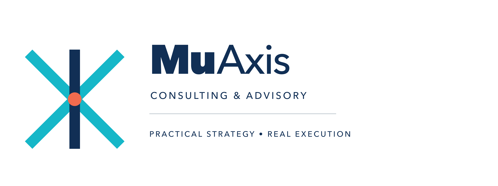

## Mukundhan S
### Independent Consultant | Energy & Utilities Digital & AI Transformation Expert
**Location:** Bangalore, India | **Email:** mukund@muaxisconsulting.com

---

### 🎯 Core Value Proposition
Enterprise digital transformation and AI strategy leader with **25+ years of domain authority** advising Fortune 500 and global infrastructure clients across electricity, gas, oil, water, renewable energy, and smart cities. 

As a former **Cognizant Director** and **Wipro Delivery Head**, I bridge the gap between complex technical architectures (AI/ML, data engineering, cloud) and C-suite business strategies, managing portfolios up to **$50M+** and delivery teams of **250–700+ professionals**.

---

### 🛠️ Strategic Frameworks & Advisory Offerings

  <h3 style="margin-top: 0; color: #0056b3; font-size: 1.2em;">🔹 Asset-Agentic Value Realization (A²VR™) Framework</h3>
  <ul style="list-style-type: none; margin-bottom: 0; padding-left: 20px;">
    <li style="color: #333333; line-height: 1.6;">An advisory-first decision intelligence layer designed specifically for asset-intensive sectors (Energy, Utilities, Manufacturing, Transportation). This multi-agent AI architecture detects, ranks, and explains critical operational and commercial decisions related to physical infrastructure.</li>
  </ul>

  <h3 style="margin-top: 0; color: #0056b3; font-size: 1.2em;">🔹 AI Value Realization & Strategy</h3>
  <ul>
    <li><strong>PE Investment Due Diligence:</strong> Frameworks linking AI experimentation to measurable ROI.</li>
    <li><strong>Responsible AI Validation:</strong> Soundness prompting and stress-testing methodologies.</li>
    <li><strong>Institutional Innovation Strategy:</strong> Foundational blueprints for research groups.</li>
  </ul>

  <h3 style="margin-top: 0; color: #0056b3; font-size: 1.2em;">🔹 Enterprise Infrastructure Advisory</h3>
  <ul>
    <li><strong>Fractional CTO & Platform Evaluation:</strong> Structural application rationalization.</li>
    <li><strong>GTM & Market Expansion:</strong> Growth roadmaps for international companies.</li>
  </ul>

---

### 📊 Track Record of Measurable Impact

  <h3 style="margin-top: 0; color: #28a745; font-size: 1.2em;">📈 Operational Efficiency & IoT Strategy</h3>
  <ul style="margin-bottom: 0; padding-left: 20px;">
    <li><strong>Metric Achieved:</strong> 20%+ Efficiency Gain / 15–20% Revenue Boost</li>
    <li><strong>Program Scope:</strong> Engineered AI/IoT-enabled municipal transformations of core functions including solid waste, asset management, green operations, and compliance frameworks.</li>
  </ul>

  <h3 style="margin-top: 0; color: #28a745; font-size: 1.2em;">🌟 Customer Experience (CX) Transformation</h3>
  <ul style="margin-bottom: 0; padding-left: 20px;">
    <li><strong>Metric Achieved:</strong> +52 NPS Point Jump / $2.5M Cost Savings</li>
    <li><strong>Program Scope:</strong> Orchestrated a massive 275+ member retail utilities transformation program involving client-centric operational redesign and increased self-service adoption.</li>
  </ul>

  <h3 style="margin-top: 0; color: #28a745; font-size: 1.2em;">✂️ Cost Optimization & Scalability</h3>
  <ul style="margin-bottom: 0; padding-left: 20px;">
    <li><strong>Metric Achieved:</strong> 35–45% Operational Cost Reduction</li>
    <li><strong>Program Scope:</strong> Architected an enterprise-wide Shared Services Strategy across HR, procurement, finance, and customer service for a major global fuel retailer.</li>
  </ul>

  <h3 style="margin-top: 0; color: #28a745; font-size: 1.2em;">⚙️ Infrastructure Modernization & SCADA</h3>
  <ul style="margin-bottom: 0; padding-left: 20px;">
    <li><strong>Metric Achieved:</strong> 30+ Legacy Systems Consolidated</li>
    <li><strong>Program Scope:</strong> Directed one of the largest Systems Integration frameworks in the Southern Hemisphere, incorporating real-time SCADA tracking into utility network operations.</li>
  </ul>

---

### 🎛️ Technical Fluency & Tooling
* **AI/ML & Data:** Python, SQL, ML Fundamentals, ETL/ELT Pipelines (PySpark), Advanced Statistical Analysis.
* **Cloud & Infra:** Docker, Kubernetes, SaaS Platforms, Infrastructure Modernization, Google Cloud Suite.
* **Enterprise & Analytics:** Oracle, Microsoft, FastAPI, Tableau, Power BI, Business/Cost Modeling.

---

### 🎓 Education & Credentials
* **Executive PG Diploma in ML & AI (GenAI)** | IIIT Bangalore
* **Executive General Management Program (EGMP)** | IIM Bangalore
* **Master’s Degree in Science**
* *Certifications:* Google Cloud Professional Tracks (Digital Transformation, Data & AI Innovation, Cloud Security & Operations)

---

### 📩 Contact & Advisory Inquiries
If your leadership team is looking to navigate legacy modernization, derisk AI implementations, or optimize infrastructure operations, let's connect.

* **Business Email:** [mukund@muaxisconsulting.com](mailto:mukund@muaxisconsulting.com)
* **Professional Network:** [Connect with me on LinkedIn](https://www.linkedin.com/in/mukundhan-s-71b6594)
